# Информационная подсистема Мебельная фабрика

Программный комплекс для комплексной автоматизации мебельного производства, охватывающий весь жизненный цикл работы предприятия, включая подачу заявки покупателем, планирование закупок, изготовление и доставку готовой мебели заказчику.

Разработка выполнена в соответствии с материалами расчетно-пояснительной записки курсового проекта по дисциплине Методы и средства проектирования информационных систем кафедры искусственного интеллекта и цифровых технологий ФГБОУ ВО ВГТУ.

---

## Архитектура и технологический стек

Проект разработан на базе объектно-ориентированного подхода и разделен на два взаимосвязанных приложения

- Windows Forms на платформе C# и платформе .NET Framework
- СУБД Microsoft SQL Server с подключением через SqlClient
- Клиентская часть FurnitureFactory-clients для конечных покупателей
- Корпоративная часть FurnitureFactory-factory для сотрудников предприятия с ролевой моделью разграничения прав доступа

---

## Функциональная декомпозиция системы

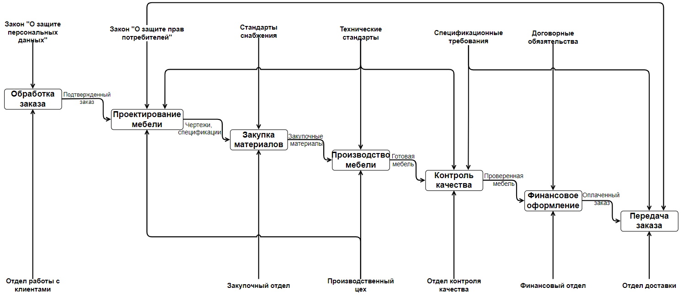

Процесс производства строится на строгой последовательности взаимосвязанных действий. Отдел по работе с клиентами принимает входящие заявки с соблюдением требований закона о защите персональных данных, после чего формируются чертежи и конструкторские спецификации согласно пожеланиям покупателей и стандартам предприятия. На основе спецификаций отдел закупок организует приобретение необходимых материалов и комплектующих. Производственный цех выполняет изготовление деталей, их последующую обработку и сборку, а отдел контроля качества проверяет соответствие готовых изделий установленным стандартам. Финансовый отдел осуществляет расчетные операции и закрывает договорные обязательства, а служба логистики обеспечивает складирование, упаковку и финальную транспортировку мебели заказчику.

---

## Диаграмма вариантов использования Use Case

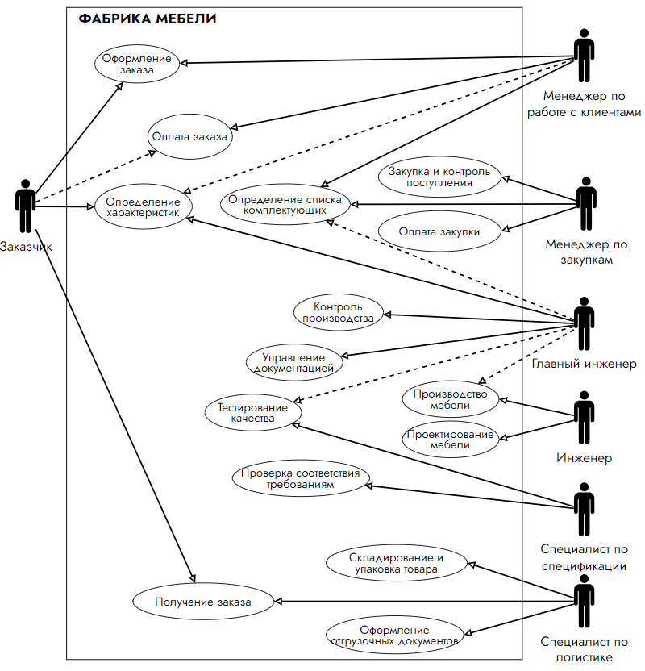

В системе задействовано несколько групп участников, каждая из которых решает свой круг задач. Заказчик оформляет заявку, согласует параметры мебели, вносит оплату и принимает доставленный товар. Менеджер по работе с клиентами обрабатывает входящие обращения, вносит данные о модели, производит расчет стоимости и направляет заказ в производство. Менеджер по закупкам формирует перечень комплектующих, контролирует поставки и при необходимости регулирует доступность товаров в каталоге. Главный инженер контролирует производственные процессы, утверждает документацию и курирует проверку качества. Инженеры и рабочие цеха ведут проектирование, сборку изделий и устранение выявленных недочетов. Специалист по сертификации проводит тестирование и подтверждает соответствие стандартам, а специалист по логистике отвечает за упаковку, складское хранение, подготовку отгрузочных документов и доставку продукции покупателю.

---

## Демонстрация работы приложения

### Видеодемонстрация рабочих процессов

Видеоролик демонстрирует последовательный пользовательский и корпоративный сценарий работы системы.

<video src="docs/demo.mp4" controls width="100%"></video>

[Скачать видеоролик демонстрации](docs/demo.mp4)

---

### Клиентский интерфейс

Клиентская часть ориентирована на удобство конечного покупателя и обеспечивает процесс выбора ассортимента и мониторинга готовности заказа.

#### Авторизация и регистрация покупателя

Пользователь проходит идентификацию по учетным данным либо регистрирует новую учетную запись с указанием контактных данных и адреса.

| Вход в клиентский кабинет | Регистрация нового покупателя |
| :---: | :---: |
|  |  |

#### Профиль и каталог доступной мебели

В личном профиле отображаются персональные данные с возможностью редактирования, а также динамический каталог актуальной продукции фабрики с фотографиями и ценами.

| Профиль покупателя | Каталог изделий |
| :---: | :---: |
| 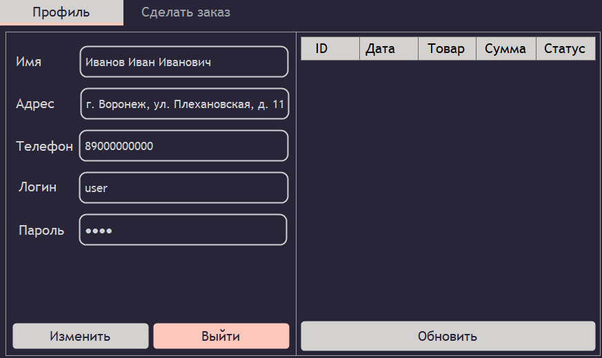 | 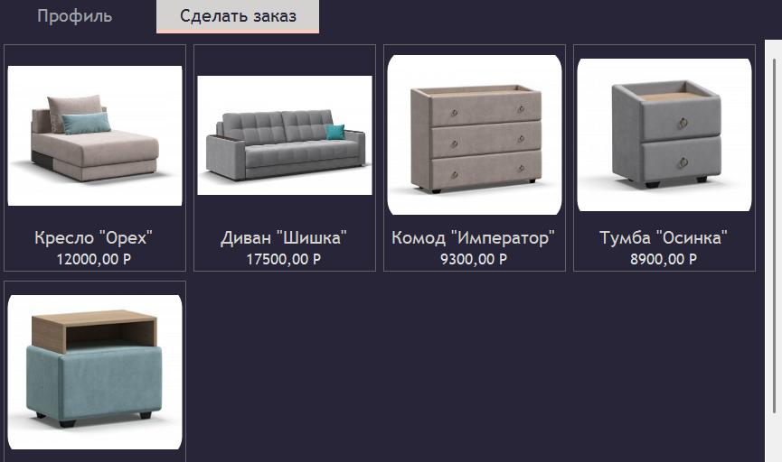 |

#### Оформление заказа

При выборе карточки мебели открывается развернутая информация о товаре, после чего заказ фиксируется в профиле со статусом ожидания подтверждения.

| Заказ в профиле клиента со статусом ожидания |
| :---: |
| 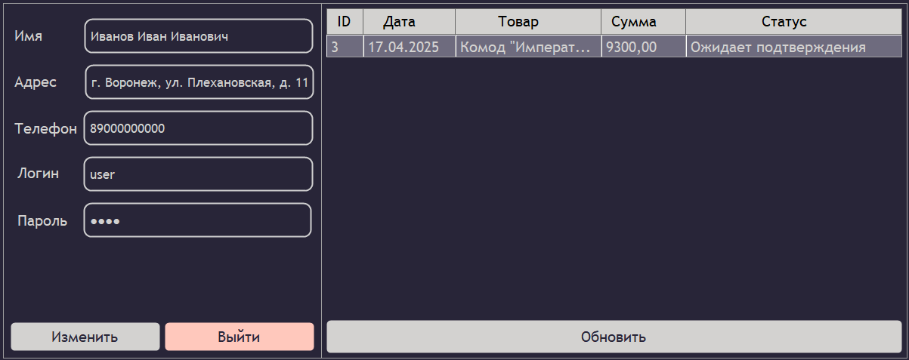 |

---

### Корпоративный интерфейс сотрудников

Корпоративный модуль разграничивает права доступа по ролям и автоматизирует сквозное прохождение заказа по отделам предприятия.

#### Авторизация персонала

Сотрудники входят в систему по персональным учетным записям, созданным администратором предприятия.

#### Панель администратора

Администратор обладает правами ведения справочника номенклатуры товаров с загрузкой фотографий и цен, а также управлением учетными записями работников фабрики.

| Управление товарами | Управление сотрудниками |
| :---: | :---: |
| 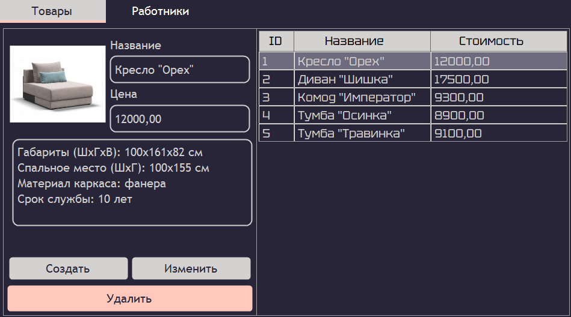 | 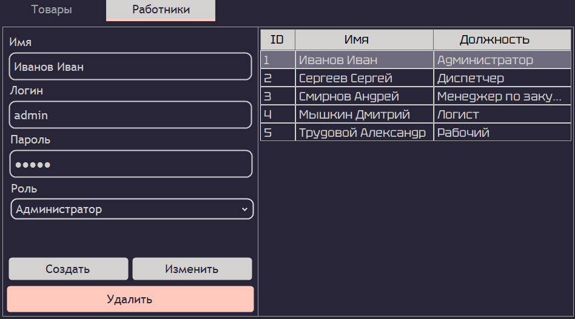 |

#### Сквозное согласование производственной заявки

Заявка последовательно переходит по этапам жизненного цикла с подтверждением каждым ответственным подразделением.

| Менеджер утверждает заявку | Рабочий фиксирует производство | Логист организует отправку |
| :---: | :---: | :---: |
| 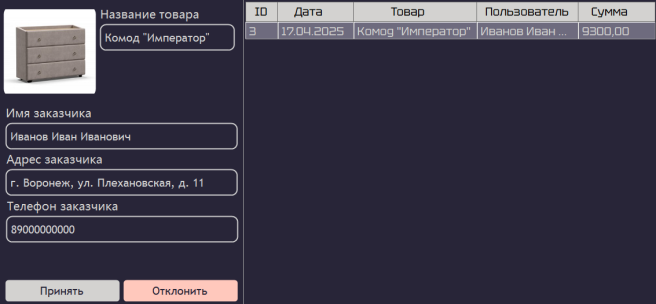 | 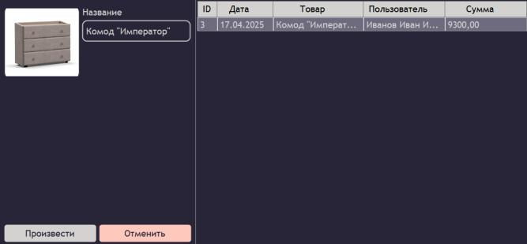 | 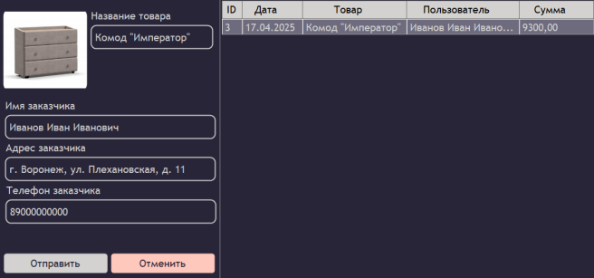 |

#### Рабочее место менеджера по закупкам

Менеджер по закупкам отслеживает материальное обеспечение моделей и при нехватке материалов временно скрывает товар из клиентского каталога до пополнения запасов.

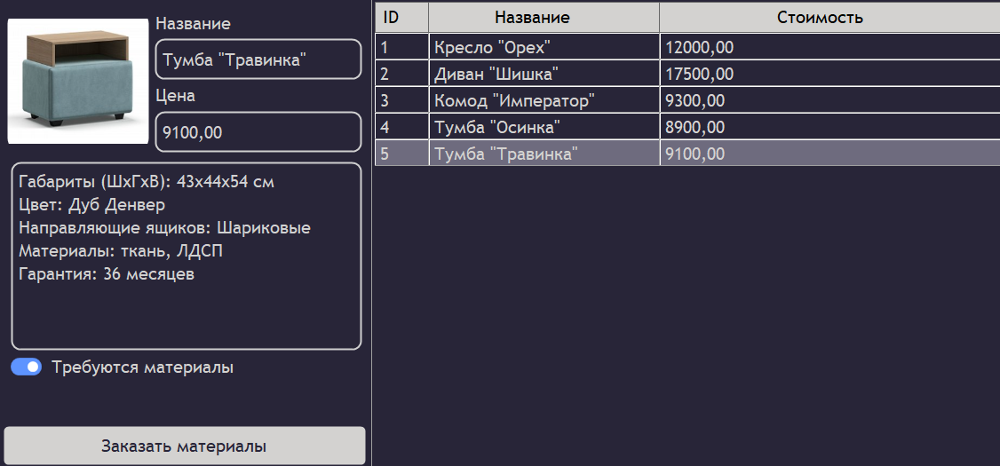
